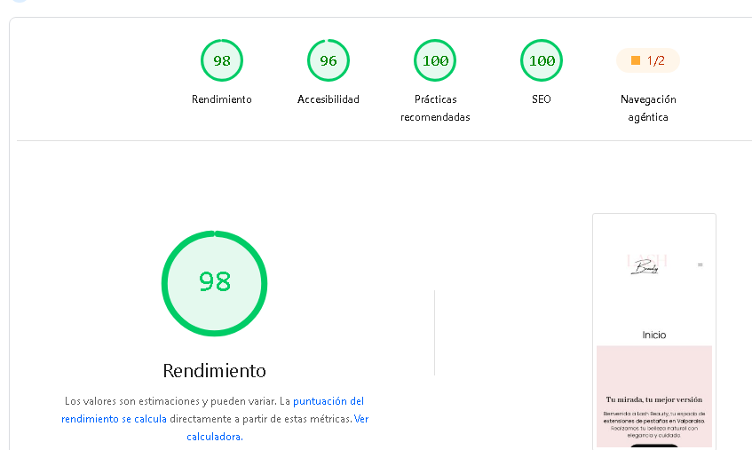

# Plantilla: `lighthouse.md`

Copia este contenido en un archivo `lighthouse.md` en la carpeta `proyecto/` de tu repo y complétalo. Vale **3 puntos** en la Entrega final.

---

# Análisis de rendimiento con Lighthouse

**Sitio analizado:** (URL de tu página de inicio en producción)
**Herramienta:** (Lighthouse en Chrome o PageSpeed Insights)
**Dispositivo:** móvil
**Fecha del análisis:** (fecha)

## 1. Resultados (1 pt)

| Categoría | Puntaje (0 a 100) |
|---|---|
| Rendimiento |98 |
| Accesibilidad |96 |
| Buenas prácticas |100 |
| SEO |100 |

**Evidencia:** (captura del informe o enlace al resultado de PageSpeed Insights)

## 2. Análisis (1 pt)

- **Qué significan mis puntajes:** Rendimiento (98) mide qué tan rápido carga mi página en el celular. Accesibilidad (96) mide si cualquier persona puede usar el sitio, por ejemplo si los colores se leen bien y si las fotos tienen una descripción para quienes no pueden verlas. Buenas prácticas (100) revisa que el sitio sea seguro y esté bien hecho. SEO (100) mide si Google puede entender mi página y mostrarla en las búsquedas. En general me fue bastante bien en las cuatro.
- **Mi mejor categoría y por qué:** Buenas prácticas y SEO, las dos con 100. Creo que me fue bien en SEO porque uso el plugin Yoast, que me ayudó con los títulos y las descripciones. En buenas prácticas creo que influyó que mi sitio usa HTTPS.
- **Mi categoría más débil y por qué:** Accesibilidad, con 96. No es un mal puntaje, pero era la más baja. Una de las causas era que algunas imágenes no tenían texto alternativo, así que les agregué uno.
- **Problemas que encontré en el informe:** Encontré cuatro cosas que mejorar. Primero, las fuentes tardan en cargar porque no tienen `font-display`, y eso se podía ahorrar 740 ms. Segundo, dos archivos CSS de WordPress bloquean que la página se muestre rápido (560 ms). Tercero, una imagen pesaba 271,7 KiB y se podía bajar unos 110 KiB. Cuarto, el árbol de dependencias de red muestra que las fuentes son lo más lento de cargar, hasta 2137 ms.

## 3. Mejoras (1 pt)

Al menos 2, propuestas o ya aplicadas.

| Mejora | Qué problema resuelve | ¿Aplicada o propuesta? | Resultado (si la aplicaste) |
|---|---|---|---|
| Achiqué la foto principal con Squoosh y la pasé a WebP | La imagen pesaba mucho y hacía más lenta la carga de la página | Aplicada | Pasó de 271,7 KiB a unos 100 KB, casi un 60% menos |
| Agregué texto alternativo a las fotos de servicios y al logo | Algunas imágenes no tenían descripción, y eso afecta la accesibilidad y el SEO | Aplicada | En el informe no vi cambio en el puntaje de Accesibilidad. Puede ser por la caché o porque algo no se guardó.|
| Poner `font-display: swap` en las fuentes | Las fuentes tardan en cargar y el texto se demora en aparecer (se podían ahorrar 740 ms) | Propuesta | Todavía no la aplico porque hay que editar el tema y no quiero romper el sitio |
| Diferir el CSS con un plugin como Autoptimize | Dos archivos CSS de WordPress bloquean que la página se muestre rápido (560 ms) | Propuesta | Falta probarlo, porque a veces desordena el diseño |

> No se evalúa que saques un puntaje alto, sino que entiendas qué mide Lighthouse y qué harías para mejorar. Reconoce los límites del hosting gratuito si influyen en tu resultado.
